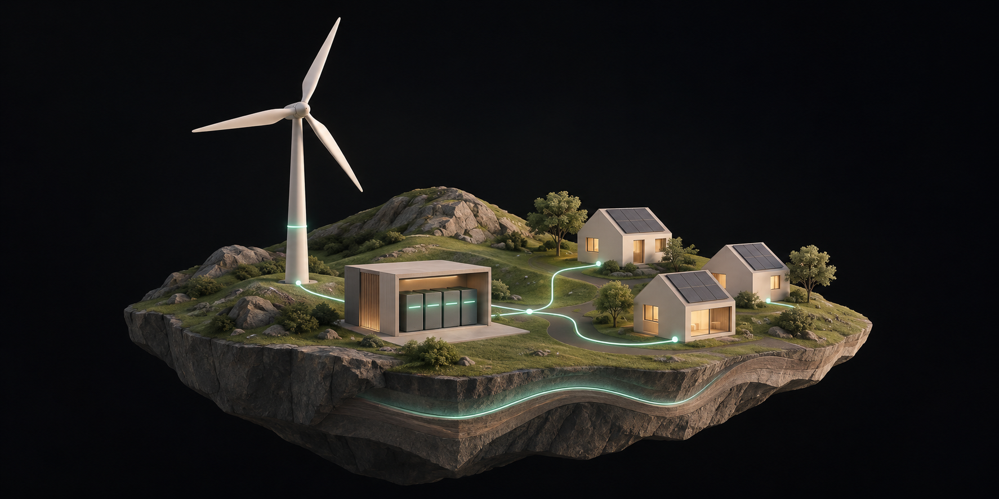

<div align="center">
  
  <br /><br />
  <h1>Île · Un monde à comprendre</h1>
  <p><strong>Comprendre un système en jouant avec ses équilibres.</strong></p>
  <p>Un prototype interactif et pédagogique autour de l'énergie, du stockage et des conséquences de nos choix.</p>
</div>

---

## Une idée simple

Sur une île, production, consommation et stockage sont liés. Modifiez un paramètre et observez immédiatement ce que cela change : le déficit ou le surplus, l'autonomie théorique de la batterie et une explication en langage courant.

L'ambition du projet est d'explorer une autre façon d'apprendre : **agir sur un système, comprendre les relations de cause à effet et rendre les hypothèses visibles**.

## À essayer

1. Faites varier la production, la consommation, l'énergie stockée ou la puissance maximale de la batterie.
2. Observez le bilan et l'autonomie se recalculer instantanément.
3. Sélectionnez un élément de l'île pour en découvrir le rôle.
4. Ouvrez les hypothèses du modèle en bas de la page.

L'interface est utilisable à la souris et au clavier et s'adapte aux petits écrans. [Pretext](https://github.com/chenglou/pretext) est utilisé pour répartir les lignes de l'explication autour d'un élément visuel lorsque la largeur disponible change.

## Le modèle en un exemple

Avec **30 MW** de production, **40 MW** de consommation et **10 MWh** disponibles en batterie, le déficit est de **10 MW**. Si la batterie peut fournir cette puissance, elle le couvre théoriquement pendant **1 heure**.

En passant la consommation à **46 MW**, le déficit atteint **16 MW** et l'autonomie devient **37 min 30 s**.

```text
déficit (MW) = max(consommation − production, 0)
autonomie (h) = énergie disponible en batterie (MWh) / déficit (MW)
```

L'autonomie n'est calculée que s'il existe un déficit et si la puissance maximale de décharge suffit à le couvrir. Une batterie vide donne une autonomie de zéro ; en cas de surplus ou de puissance insuffisante, l'indicateur affiche un tiret.

> Ce modèle pédagogique suppose une production et une consommation constantes, sans pertes. Il ne représente pas les contraintes d'un réseau électrique réel et ne constitue pas un outil de prévision ou de dimensionnement.

## Démarrer en local

Prérequis : **Node.js 24** et npm.

```bash
npm install
npm run dev
```

Ouvrez ensuite l'adresse locale indiquée dans le terminal. Pour vérifier les calculs et construire l'application :

```bash
npm test
npm run build
```

## Sous le capot

- **React, TypeScript et Vite** pour l'application côté navigateur.
- **Tailwind CSS et composants shadcn/ui** pour une interface simple et accessible.
- **Pretext** pour mesurer et disposer les lignes de l'explication.
- **SVG** pour représenter l'île et ses éléments interactifs.
- Un modèle de calcul indépendant de l'interface, accompagné de tests.

Le prototype fonctionne localement, sans compte ni serveur de données. La comparaison de scénarios, la collaboration, les jeux de données réels et les contraintes avancées sont des pistes d'évolution, pas des fonctionnalités déjà présentes.

## La suite à explorer

La première question est pédagogique : **la manipulation de ce petit monde aide-t-elle réellement à comprendre les liens entre production, consommation et stockage ?** Les retours d'utilisation pourront guider les prochaines expériences : comparaison de stratégies, données externes, scénarios partagés ou nouveaux systèmes à explorer.
